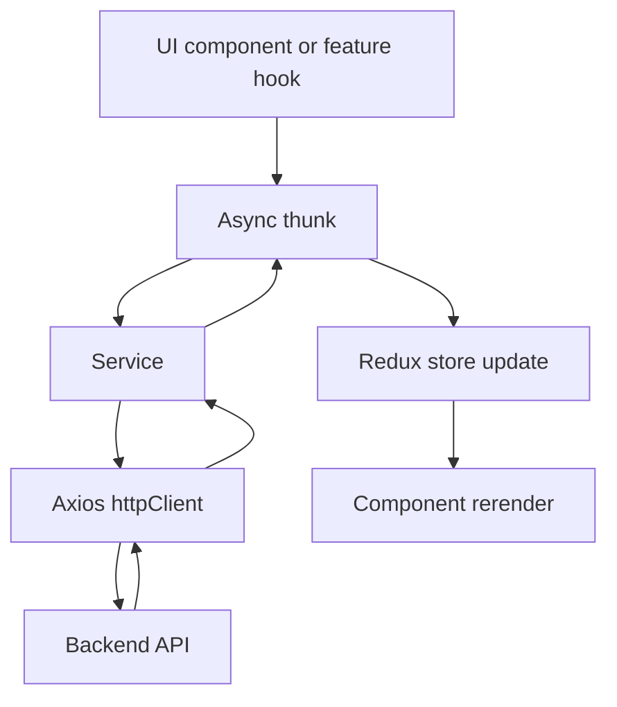
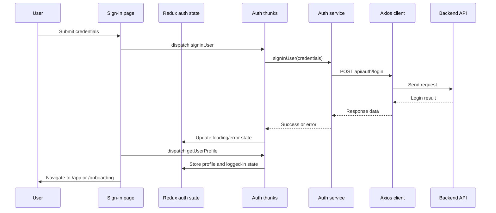

# State and Data Flow

The application uses Redux Toolkit as its main shared state layer. Backend calls are wrapped in services under `core/api/services`.

For slice-level details, see the [State Reference](../state-reference.md). For endpoint/service details, see the [Frontend API Reference](../frontend-api-reference.md).

## Main state patterns

| Pattern | Current use |
|---|---|
| Redux Toolkit store | Shared application state, including auth, products, admin data, Creator data surfaces, reviews, notifications, cart, and wishlist. |
| Async thunks | Common pattern for backend-backed actions such as login, profile loading, product operations, and admin operations. |
| Services | API layer functions that call the shared Axios client and return response data. |
| React Query | Used narrowly for product search and autocomplete flows. It is provided globally but is not the default data layer everywhere. |
| Local component state | Used for form inputs, UI state, filters, tabs, dropdowns, and workflow-specific state. |
| Browser persistence | Used for cart and wishlist state. Auth persistence depends on backend/session behavior and profile loading. |

## Typical request flow

Most Redux-backed server interactions follow this architecture:

For React Query-backed search flows, the component calls a query function that uses the same product services and Axios client.

## Sign-in flow example

Sign-in follows the same pattern, with auth state and routing layered around the API call:

## Redux Toolkit

State is split into slices by broad concern, not by route. Examples include authentication, products, admin data, reviews, notifications, cart, and wishlist.

Slices commonly define:

- Local state shape.
- Reducers for client-side updates.
- Async thunks for backend calls.
- Extra reducers for pending, fulfilled, and rejected states.

Selectors live next to their slice folders where present.

## API services

Services live under `src/core/api/services`.

They are manually written wrappers around the shared Axios client. The client handles the base URL, credentials, CSRF handling, refresh-token handling, and optional local mocks.

This keeps most components and thunks from constructing raw HTTP requests.

Current Creator data surfaces use the production-shaped path from component to Redux, thunk, service, Axios, and then either backend or a local HTTP mock when mock mode is enabled. Feature components should not select business fixtures directly based on mock mode.

## Local state and feature state

Not all state belongs in Redux.

Local UI state stays in components or feature hooks when it does not need to be shared globally. The product builder is the richest example: it uses feature hooks and a facade to coordinate form state, loading, autosave, sidebar navigation, and product actions before crossing into Redux and services.

Membership domain state is Product-scoped and stored in the Membership Redux slice. Native Membership content, included Product feed entries, ordering mode, and manual movement behavior cross into Membership thunks and implemented backend services.

The Membership feed combines two separate concepts: native Membership content and included standalone Products. `MembershipFeedEntry` provides the stable feed identity plus relationship metadata such as `addedAt` and optional ordering position/state. Product remains authoritative for product identity, name, description, status, image, and recurring-pricing fields; Membership owns configuration, native content, included Product associations, and feed/order metadata.

Membership editor drafts, selected File objects, chooser state, picker state, active editor state, active builder tab, and readiness evaluation remain local UI state.

Storefront Builder keeps unsaved Storefront configuration changes in local UI state until Save. Theme, featured Product selection, and Product ordering are saved through the Storefront config thunk/service path. Inline public profile edits, including public email, use the User/Profile update path rather than the Storefront config path.

Product Landing Page Builder keeps unsaved landing-page configuration changes in local UI state until Save. Marketing description, hero layout, supported section visibility, and supported section order are saved through the Product Landing Page config thunk/service path. Canonical Product fields continue through Product state/services; Storefront theme and User/Profile or public Storefront Creator identity are composed into the public view model rather than copied into landing-page config.

## Persistence and side effects

The cart and wishlist are browser-saved with `localStorage`.

Product-related success notifications are created through Redux listener middleware. Sonner is mounted globally for toast UI, but Redux notifications and Sonner usage are not the same system in the current implementation.

## Accessibility and interaction conventions (M12)

M12 is merged in [PR #82](https://github.com/app-video-platform/video-platform-ui/pull/82)
as `0effcc78b76c639ab091bc94e921aa394212b2bc`, implementation
`f41155f7c24c6744776b87fdb9a64b7302d682f2`. Merged source does not establish
that an environment has deployed it or completed accessibility verification.

Use the shared [Drawer ownership contract](../components/drawer.md#overlapping-dialog-ownership-m12)
for overlapping dialogs and [native field semantics](../components/form-input.md#native-field-states-and-textarea-identity-m12)
for disabled/read-only fields and Textarea IDs. Labels must target their controls;
icon-only actions need names; visible actions use native interactive elements.
Creator SidebarNav supplies `aria-label={route.label}` to links and the disabled
Help button, preserving names when text disappears on collapse. NavLink retains
active-route `aria-current`; Help remains unavailable. UserDropdown's native
Logout button keeps the existing authenticated session flow. Dropdown dismissal
does not supply a general focus-restoration contract.

### Notification presentation boundary

`NotificationsDropdown` names its button **Notifications**, exposes `aria-expanded`
and links the mounted panel through `aria-controls`. `notifications.slice.ts`
initializes new entries with `isRead: false`; the dropdown renders **Unread** when
`!notification.isRead`, and omits that text for read entries. The visible text is
also programmatically available, so state is not conveyed solely by color. It
preserves list order and displays **No notifications to show** for an empty list.
Tests cover keyboard opening/Escape, mixed read/unread fixtures and empty state.

Product success listeners create these Redux notifications; they are
session-local and reset on full reload and M1 account/session boundaries. Reducer
`markAsRead`/remove actions are not user-facing menu controls. M12 adds no server
delivery/history, persistence, read synchronization, mark-as-read UI or notification
preferences. Settings Notifications remains an M9 local-validation placeholder;
Sonner toasts are a separate presentation system.

### Theme pairs and verification boundary

Cart, Wishlist and Notifications dropdown styles pair `--surface-panel-elevated`
with `--text-primary`, replacing white consumer panels that inherited near-white
text. Cart/Wishlist primary actions pair `--brand-primary` with `--text-inverse`,
with existing light/dark brand hover/active variants. LegacyExpansionPanel pairs
`--surface-panel` with `--text-primary` for Course content and header; its region
uses instance-specific header/content IDs. M5 collection recovery/transitions,
M7 Article rendering/sanitization and M11 pricing semantics remain unchanged.

When changing surfaces, check text, links, buttons, state labels and focus
indicators together across empty/populated/expanded, interactive and relevant
theme states. An inherited foreground can break a locally chosen background.
Unread text uses `--brand-primary`; preserve the textual state indicator.

PR #82 reports theme-token pair calculations meeting the WCAG AA normal-text
target, not measured runtime computed-style combinations. It reports 923 tests /
132 suites, TypeScript, ESLint (0 errors / 185 warnings), a production build with
three existing Webpack size/performance warnings, and `git diff --check`.
Reported synthetic browser checks: collapsed Creator names, Settings disabled
states, keyboard account-menu opening, and single Sales Order Drawer
Escape/focus restoration. Actual Sales Order + Filters overlap, browser Landing
labels, populated notifications, computed contrast across affected menus and
expanded Course Articles, manual screen-reader behavior and deployed parity
remain unverified. Axe is not installed as a project dependency; no axe run or
screen-reader audit is claimed. Automated DOM tests and token arithmetic do not
establish full WCAG compliance or universal theme/browser coverage. See the M12 retest matrix in the repository's `qa/test-execution-plan.md`.

## Choosing where state belongs

Use this as a practical guide:

| State type | Usual location |
|---|---|
| Shared auth/session/user state | Redux auth slice. |
| Backend-backed product/admin/review state | Redux thunk + API service, unless the existing feature already uses React Query. |
| Backend-pending Creator data contracts | Redux thunk + API service + Axios, with local HTTP mocks only at the Axios boundary. |
| Search/autocomplete server state | Existing React Query pattern. |
| Form draft and UI interaction state | Local component or feature hook, including unsaved Storefront Builder and Product Landing Page Builder config drafts. |
| Reusable browser-saved cart/wishlist behavior | Existing Redux slices and persistence patterns. |

## Account and session boundaries

M1 keeps `sessionStatus` (`resolving`, `authenticated`, `unauthenticated`, `unavailable`) and `sessionVersion` in the Auth slice. Login attempts, explicit logout, authentication invalidation and identity/role transitions advance the version. Local logout applies before the server request settles and remains effective on failure.

`src/core/store/root-reducer.ts` atomically clears account-owned Admin, reporting, Product, Membership, notification, review and Creator presentation state when the version changes. Product reads mix public metadata and private drafts, so the entire Product cache is cleared. Separate public Storefront reads remain; public landing-config entries also written by Creator saves are removed. Cart/Wishlist retain their browser-local shopping lifecycle and are not entitlements. Current React Query search/autocomplete reads are public catalogue data.

`session.middleware.ts` must run before Product notification listeners. It associates thunk request IDs with session versions and drops old-session fulfillments and rejections before reducers/listeners, preventing cache repopulation and stale notifications. Add new account-owned thunk namespaces to its scoped-prefix list. Public Storefront and landing-config fetches are exempt. This does not replace feature-level query/entity freshness checks. The [HTTP client](../api/http-client.md) also rejects stale private responses.

## Active read request ownership (M8)

Merged [PR #78](https://github.com/app-video-platform/video-platform-ui/pull/78)
tracks freshness in the existing slices using Redux Toolkit's `meta.requestId`.
There is no global request manager or new API contract. Source version:
implementation `a0e0c3b`, main merge `ee826e5` (3 November 2026); GitHub comparison
shows the implementation is contained in main with no file differences.

| Read channel | Active selection and status | Implementation |
| --- | --- | --- |
| Product detail | `detailRequestId`, `detailProductId`, `detailLoading`, `detailError` | [product.slice.ts](https://github.com/app-video-platform/video-platform-ui/blob/a0e0c3b163a8ff626a6c22580bcc99bc71fd7d9d/src/core/store/product-store/product.slice.ts) and `product.selectors.ts` |
| Creator Customer detail | `detailRequestId`, `detailCustomerId`, `detailLoading`, `detailError`, HTTP `detailStatus` | [customers.slice.ts](https://github.com/app-video-platform/video-platform-ui/blob/a0e0c3b163a8ff626a6c22580bcc99bc71fd7d9d/src/core/store/customers-store/customers.slice.ts) |
| Creator Order detail | `detailRequestId`, `detailOrderId`, `detailLoading`, `detailError` | [sales.slice.ts](https://github.com/app-video-platform/video-platform-ui/blob/a0e0c3b163a8ff626a6c22580bcc99bc71fd7d9d/src/core/store/sales-store/sales.slice.ts) |
| Admin Products / Audit | Independent `productsRequestId` / `auditRequestId`, query keys, loading and errors | [admin.slice.ts](https://github.com/app-video-platform/video-platform-ui/blob/a0e0c3b163a8ff626a6c22580bcc99bc71fd7d9d/src/core/store/admin-store/admin.slice.ts) |

Detail pending records the request and target IDs, clears the prior detail/error,
and starts its own loading state. Fulfilled and rejected handlers write only
when both IDs match. Stale completions perform no writes: they cannot replace
data/errors, erase newer data, or end a newer request's loading. Matching
completion releases the request ID but retains the target for settled status
matching. Request IDs distinguish duplicate same-target reads and A → B → A
navigation; matching the entity ID alone is insufficient.

`clearCurrentProduct`, `clearCurrentCustomer`, and `clearCurrentOrder` invalidate
pending ownership and clear detail/status. Product Overview, CustomerDetail and
the Sales selection effect clean up on selection change/unmount. Route/selection
ID guards prevent another entity from appearing during the render before the
new request effect runs. The Customer tabs reset to Overview. The Sales drawer's
open state follows the `order` query parameter, with loading/error/Retry inside
the drawer; close removes that query and invalidates the pending read.

Product detail consumers use the detail selectors rather than list/mutation
status. Preview, public Product, landing-page builder and workspace initial
loading use that channel; existing authoring mutation/autosave feedback remains
separate. Customer and Sales retain their existing list/detail separation.

Admin pending stores `JSON.stringify(action.meta.arg ?? {})` as the channel's
query key and clears that channel's results/error. Only the owned request may
settle. Pages compare a query built with the same field order before showing
rows/errors: Audit uses action, targetType, targetId, page, size; Products uses
search, ownerId, type, status, page, size. Filters reset page to zero. Pending or
query mismatch hides old rows and disables paging; successful empty results and
errors with Retry are distinct. Input case and service query serialization are
preserved; the backend determines matching semantics. Product deletion refresh
reads the latest query ref when it completes rather than an older click closure.
Product and Audit requests do not modify the legacy Admin `loading`/`error` used
by Users and role operations; their dedicated selectors isolate all three
channels. This is a frontend safeguard, not server response-ordering behavior.

Customer detail rejection retains Axios HTTP status and a safe generic message.
HTTP 404 renders unavailable/not-found feedback; other failures render generic
load/retry feedback without raw backend details or internal IDs. The same 404
can represent nonexistent or inaccessible Customers. See [Customers](../../product/creators/customers.md#detail-loading-and-recovery).

These guards complement [M1 session isolation](#account-and-session-boundaries),
which remains authoritative for account transitions. Navigation/clear invalidates
state ownership without adding transport cancellation. M1 retains its existing
session-generation checks, private-cache reset and Axios cancellation; late reads
cannot populate a new account. Freshness does not authorize reads or revoke
server operations that have already committed.

### M8 verification boundary

PR #78 and `M8_DOCUMENTATION_HANDOFF.md` report **836 tests / 121 suites** and
**58 focused tests / three suites**, TypeScript, ESLint (0 errors / 195 warnings),
whitespace checks, and a production build with mocks disabled in **30.173 seconds**
(three existing Webpack bundle-size/performance warnings). The two new suites
contain 54 controlled ownership/component tests; the focused run also includes
the four Admin reducer tests.

`src/core/store/request-freshness.test.ts` controls responses through actual
thunks/services/root reducer and M1 middleware: B-before-A, A while B pending,
stale success/rejection, current failure/retry, A → B → A, duplicate same-ID reads,
clear/reopen and session changes. `src/domains/app/pages/request-freshness.integration.test.tsx`
asserts rendered Product/Customer/Sales/Admin behavior, safe Customer 404/503/network
feedback, combined Admin filters, mixed-case serialization, paging and empty/error
recovery. `admin-store/admin-slice.test.ts` also asserts legacy Users status stays
unchanged by Product completion/failure.

Reported local synthetic browser checks covered Product Overview, Customer
switching/404 feedback and Sales selection/close/reload. Admin filter races and
controlled response ordering were automated-test coverage, not browser E2E.
Deployed Product/Customer/Sales races, live Admin queries, backend/network timing
and final deployment QA remain unverified. Documentation work does not rerun or
resume the paused QA execution.

## Profile and integration save feedback (M9)

Merged [PR #79](https://github.com/app-video-platform/video-platform-ui/pull/79)
is main merge `8674513d3015c718bb0b6ff7c1746916b323b758`, implementation
`8cc07e31fd2f903aedc5709f45be6bcedc21e910` (3 November 2026). GitHub comparison
confirms that implementation is contained in main with no file differences.
M9 extends operation ownership to Profile and Landing Page saves while preserving
[M1 account isolation](#account-and-session-boundaries) and [M8 read freshness](#active-read-request-ownership-m8).

### Profile mutation ownership

`src/core/store/auth-store/auth.slice.ts` keeps `profileUpdateRequestId`,
`profileUpdateLoading`, and `profileUpdateError` separate from session/profile
resolution and generic Auth loading/error. `updateUserDetails.pending` claims the
RTK request ID and clears the prior mutation error. Only the current request may
fulfill/reject; success releases ownership, clears loading/error and accepts the
returned User, while current failure exposes only that mutation's error. Stale
outcomes cannot replace newer shared User data or settle its operation status.
Unrelated authentication errors are preserved. `beginSession` clears profile
mutation ownership/status; existing session middleware remains authoritative.

Use `selectProfileUpdateLoading` / `selectProfileUpdateError` for profile updates,
not generic Auth selectors. `settings-profile-tab.component.tsx` validates through
React Hook Form submission before awaiting `.unwrap()`; Save is a submit button
and success follows fulfillment. User response changes rehydrate the form.
Supported fields, optional email clearing, social URL mapping and validation
limits are in [User API](../api/user.md#notes). Phone/image editing is disabled.

Storefront inline profile editors dispatch the same operation and retain their
own field-local failure. Rejection leaves the editor/draft open; successful retry
clears its error and closes the editor. The page uses profile-update loading and
no longer turns a generic Auth error into a Storefront save alert. Product-list,
Storefront-config loading, and config-save feedback remain separate. This guards
frontend state; it does not serialize concurrent server writes, cancel a committed
write, or establish backend last-write ordering.

### Landing Page save boundary

`product-landing-page.slice.ts` uses `creatorSaveRequestId`,
`creatorSaveLoading`, and `creatorSaveError` separately from Creator config read
status. Real save pending claims the current request; only matching outcomes may
settle it or update config caches. The thunk maps HTTP 403 to **You do not have
permission to save this landing page.**, 404 to **This landing page is unavailable.**,
and other failures to **Could not save the landing page. Please try again.**

`ProductLandingPageBuilder.save` catches the rejected `.unwrap()` at the action
boundary, preventing an unhandled click-handler rejection. It clears old success
before the attempt, preserves the local draft on failure, and shows **Landing
page saved.** only after fulfillment. Draft retention is local to the mounted
Builder; this introduces no reload persistence, publishing capability or ownership
bypass. Existing Product-scoped backend config authorization remains authoritative.

### Calendar and placeholder Settings

Calendar initialization uses local `connecting` / `connectError` and a guarded
async action, not a new Redux request manager. Pending disables Connect/provider
selection. Rejection or an absent/invalid HTTPS authorization URL sets a safe
`role="alert"`; `finally` restores controls and provider changes clear old errors.
The backend creates the URL; only its returned, parseable HTTPS address is opened.
Calendar logs use fixed failure summaries. See [Calendars API](../api/calendar.md#current-frontend-usage)
for contract, provider discovery and OAuth verification boundaries.

Subscriptions, Privacy, and Notifications remain React Hook Form placeholders.
Their input blur handlers trim through `onChange`, call `field.onBlur()`, and
`trigger(field.name)` with the existing optional 2–50-character title rules.
Shared Input associates the displayed error through `aria-invalid` and
`aria-describedby`. Valid correction clears the touched field's error. Privacy
has the correct label. There is no preference save thunk or new backend support;
validation alone does not persist these forms. Phone and profile-image editing
also remain unavailable.

### M9 verification boundary

PR #79 and `M9_DOCUMENTATION_HANDOFF.md` report 848 tests / 125 suites,
TypeScript, ESLint (0 errors / 185 existing warnings), whitespace checks and a
mocks-disabled production build in approximately 31 seconds (three existing
Webpack bundle-size/performance warnings). The handoff records a final targeted
19-test / five-suite run and a subsequent 3/3 Profile rerun after optional public
email clearing was adjusted. Do not imply that the full suite was rerun after
that final adjustment.

Automated evidence inspected: Profile component tests prevent invalid submission,
assert the supported PUT payload (including empty public email), form-submit
success and 503 failure; Auth reducer tests reject stale mutation outcomes while
preserving unrelated Auth errors; Storefront tests cover failed Title save/retry;
Landing Page component tests cover 403 containment, draft retention and no success,
with reducer coverage for late failure after newer success. Calendar tests cover
Microsoft failure/retry and Google's missing URL using stubbed `window.open`.
Placeholder tests cover blur minimum/maximum, error associations and correction
in all three forms. Inspect the corresponding tests beside the components and
`auth-store/auth-slice.test.ts` / `product-landing-page-store/product-landing-page.slice.test.ts`.

No browser-driven or live-backend E2E verification was performed for M9. Deployed
Profile save/reload and role behavior, live Storefront/Landing recovery, backend
simultaneous-write ordering, real authorization configuration, cross-origin
Calendar behavior, real Microsoft/Google consent/callbacks and synchronization
remain unverified. Prior BUG-081 backend work is separate from M9 initialization
feedback; an operational Trello completion status is not deployed/provider proof.
No provider URLs or live-account mutations were exercised for this docs update.

## Discovery search state (M10)

Product discovery keeps its existing React Query path rather than moving reads
into the M8 Redux channels. The URL owns committed `term` and zero-based `page` at
`/app/explore/search`; SmartSearch keeps only the editable/debounced input and
selection locally. Results key on term/page/size, while autocomplete keys on its
debounced term. Old responses remain isolated to their keys; changing input also
invalidates a highlighted prior suggestion before debounce completes.

New/same-term submissions reset page to zero, pagination creates history entries,
and URL traversal restores committed state. Invalid page normalization uses
replace, not a feedback effect that overwrites Back/Forward with local page state.
Canonical Creator links use `appRoutes.store(creatorId)` and the public route.

See [Search request, URL and combobox behavior](../components/search.md#smartsearch-query-ownership-m10)
for exact keys, page parsing, keyboard behavior and M10 verification. M1 session
boundaries, Product visibility and M5 entitlements remain unchanged; discovery
navigation is not access authorization. M10 improves pagination presentation,
but [BUG-013 still requires backend correction](../backend/products-and-authoring.md#pagination-metadata-dependency-bug-013).
The client retains the API's last/total-page contract and does not infer unseen
pages or create a parallel continuation mechanism.

## Product and Storefront presentation (M11)

Merged [PR #81](https://github.com/app-video-platform/video-platform-ui/pull/81)
is main merge `a2f56952c062c14973761cc4ee8b7a51f42e16bc`, implementation
`bfc7a643551160c45fce999ead9675f389c53a6e` (4 November 2026). Source comparison
confirms that implementation is contained in main with no file differences.
Product price normalization stays at the existing API boundary; [Products API](../api/products.md#price-response-normalization-m11)
describes exact accepted representations and precision limits. Product
inspection and landing-price helpers consume normalized values. M8 detail
request ownership, M1 session boundaries and M5 entitlement enforcement remain
unchanged; these presentation fixes do not rewrite checkout or Order snapshots.

### Public profile copy and optional values

The shared `features/storefront/components/storefront-public-page.component.tsx`
`renderEditable` helper prioritizes a non-nullish editable renderer result, then
an existing value with nonempty `trim()`, then fallback/empty text. Nonblank
saved copy is returned as supplied. Public Title/Bio outer row guards omit null,
undefined and empty-string rows; whitespace-only strings reach the helper and
show **Creator** / **Add a public bio.** The Builder's editable renderers retain
their controls. This preserves the public profile read model and M9 save behavior;
it does not expose login email or private Creator configuration.

Consultation Overview now checks both null and undefined before appending
`minutes` for before/after buffers. Its definition-list helper omits empty rows;
zero and positive minute values remain visible. Duration, availability and
Calendar behavior are unchanged.

### Derived Storefront order

`features/storefront/storefront.utils.ts` applies configured IDs first, deduped
and limited to existing Products. For remaining Products, `orderStorefrontProducts`
requires valid `createdAt` for every item before deriving newest-created order.
Equal millisecond times compare available fractional timestamp digits (up to
nine), then valid UUIDs compare in ascending Java `UUID.compareTo` order: signed
most-significant 64-bit half, then signed least-significant half. This is not
ordinary unsigned string ordering. Non-UUID IDs retain the existing lexical
fallback. The comparator mirrors the recorded public-order convention; it adds
no new backend sorting guarantee.

If any remaining creation timestamp is missing/invalid, all remaining input
order is preserved after explicit IDs. Missing metadata cannot establish public
parity. The Builder derives display order without modifying draft/saved
`productOrderIds`; dirty comparison and Save/Reset use the config itself. The
shared view model filters public Products to Published and keeps a valid
featured ID, otherwise choosing the first eligible Product in effective order.
Public read-model presentation retains the API's order instead of re-sorting it.
Deployed creation metadata, timestamp precision and comparator parity still
require verification.

### Cross-owner landing view model

`ProductLandingPageBuilder` checks Product `userId` against signed-in User ID and
the Creator role. Only that Creator owner calls `fetchCreatorStorefrontConfig`
(`GET api/creator/storefront`) and supplies their profile/private theme to the
view model. Other authorized viewers, including Admin, select the owner-keyed
public Storefront cache and call `fetchPublicStorefront(product.userId)` when
needed (`GET api/storefronts/:creatorId`). The shared landing model prefers that
public Creator profile/theme. A current User profile fallback requires matching
Product owner ID; unavailable public owner data must not become Admin identity
or Admin theme. Missing theme uses the existing default. Enabled Creator sections
require available identity. Product-scoped landing config authorization and
private/Published Product boundaries remain unchanged; this broadens no private
Storefront permission.

### M11 verification boundary

PR #81 and `M11_DOCUMENTATION_HANDOFF.md` report 913 tests / 129 suites and 48
focused tests / five suites, TypeScript, ESLint (0 errors / 185 existing warnings),
whitespace checks and a successful mocks-disabled production build with three
existing Webpack asset/entrypoint/performance warnings.

Inspected tests cover price normalization and four-type price presentation,
month/year and Free semantics, public title/bio plus whitespace fallback,
null/undefined/zero/positive buffers, explicit/default/missing-metadata order,
signed-UUID tie-break, featured eligibility and no dirty save from derived order.
Four-type Admin Builder tests assert owner public identity/theme, no private
Creator-config request, and no Admin identity substitution when owner data fails.
Tests also cover public/private price presentation; they do not establish live
backend parity. Relevant tests sit beside the normalizer, Storefront utilities/
public component, Overview, Builder, private preview and public Product page.

Reported synthetic browser checks confirmed public Storefront title/bio after
reload and the same paid Course price in Overview, public Product, private
preview and owner Landing Builder. String-priced Download, null buffers,
empty-order and foreign Admin cases were automated coverage, not browser E2E.
Live Product normalization across all types, deployed creation metadata and
Builder/public order parity, live Admin cross-owner previews and full deployed
four-role E2E remain unverified. No backend or deployed business mutation was
performed for this documentation update. BUG-013's M10 pagination dependency
remains open and unchanged.

## Saved workspace and nested authoring

M2 preserves the shared `ProductForm`, two-step Draft creation and separate persistence contracts. All hooks execute before loading/error/access returns for saved Course, Download, Consultation and Membership workspaces. `use-product-loader.hooks.ts` ignores completions after cleanup or route identity changes; changing the legacy normalization callback alone does not reload or replace the draft.

`use-nested-autosave.hook.ts` keeps each Section/Lesson's last confirmed snapshot, latest dirty revision, two-second debounce and in-flight promise. Writes serialize per entity and newer edits follow the in-flight revision. Failure retains dirty state and exposes inline retry. Lesson reordering retains its entity queue. M7 Section/group ordering uses a separate batch queue described below; section detail snapshots omit position. Deletion waits for relevant mounted saves.

`nested-autosave-context.ts` registers mounted flush handles, not another persistence store. Workspace tabs await nested writes before unmounting editors. Products departure, Preview and Publish flush nested writes, then Product details, then recheck nested writes. Waiting shows **Saving changes before continuing…**; failure keeps the editor and offers **Retry saving**. Retry saves in place, after which the user chooses navigation again.

Product details exclude Sections/Lessons and Membership content/feed from their autosave payloads. Sections, Lessons, Download files, Membership operations and Product media keep their separate APIs and feedback. Header save status does not guarantee successful uploads or every independent operation. `beforeunload` warns best-effort; browser termination and forced/history navigation have no asynchronous persistence guarantee with the current BrowserRouter.

Membership aggregate request state is keyed by Product ID and request ID with loading/loaded/failed status and error. `ProductForm` loads an unrequested aggregate once, then requires **Retry Membership load** after failure. Rerenders/tab changes do not automatically retry. Only the matching request owns its result. Membership publishing, checkout, subscriptions, entitlements, member access and binary Video/Resource delivery remain unavailable; Course binary video persistence remains backend-pending.

M1+M2 integration tests use the real guard, root reducer, session middleware and HTTP interceptors. Dirty Section/Lesson revisions pause during unavailable confirmed identity and survive mounted same-session recovery; old-session nested saves cannot restore state or navigate the new account. Frontend cancellation cannot revoke a server write that already committed.

## Verification boundary

Merged [M1 PR #71](https://github.com/app-video-platform/video-platform-ui/pull/71) records 627 tests across 102 suites, TypeScript, lint (0 errors, 205 existing warnings), production build (3 performance warnings), and earlier mocked-HTTP browser checks not rerun during PR preparation.

Merged [M2 PR #72](https://github.com/app-video-platform/video-platform-ui/pull/72) and `M2_DOCUMENTATION_HANDOFF.md` record 664 tests across 103 suites after M1 integration, including 29 focused compatibility tests (21 workspace integration tests). TypeScript, lint (0 errors, 205 existing warnings) and production build (3 performance warnings) passed. Earlier intercepted-HTTP browser checks passed for four-type reopen/reload, Article round trips, nested navigation/failure/retry and Membership recovery on the original M2 baseline; fixture destination pages were used and checks were not rerun after final integration.

These establish merged frontend implementation and synthetic verification. Live-backend E2E remains pending for real cookie rotation, cross-origin deployment, refresh/logout ordering, persisted authoring/navigation and account/role journeys. Deployment/final QA confirmation is not established. No new authentication endpoints or backend guarantees are implied.

## M7 Course content and ordering

QuizWizard binds Auto-Split to `QuizDraft.totalScore`. `Number(value)` must be a positive integer; empty, zero, negative, fractional and non-numeric drafts show **Enter a whole number greater than zero.** without updating model allocations. `autoSplitQuizPoints` uses floor(total/questionCount) and assigns one remainder point to successive questions in array order. Manual Split uses `syncTotalScoreToPoints` and a read-only total; switching back redistributes it. Passing-score handling is unchanged, not newly validated by this fix. The mode itself remains local editor state.

QuestionCard uses `useId()`-based names/IDs for Points/Explanation, and QuizWizard keys cards by `q.id`. Add/remove/move retain identity for surviving cards, normalize positions when appropriate and preserve label associations. Native button controls expose Move question N up/down and Remove question N names with boundary moves disabled. Do not infer verified screen-reader speech from component focus tests.

CreateProductSections queues complete reorder batches through `orderQueueRef`. Within one batch it dispatches independent position PATCHes concurrently and uses Promise.allSettled; any rejection makes that order fail. Only the latest revision updates saving/error feedback; a successful latest batch clears the order error after every response succeeds. Retry order save uses the current section list. Title/description autosaves omit position, avoiding debounced writes racing the order queue. Deletion flushes registered nested saves, deletes, normalizes remaining positions and enqueues their save.

The order queue is separate from the mounted nested autosave registry; do not extend its navigation contract to guarantee order persistence on unmount, forced/history navigation or browser termination. Independent PATCHes are non-atomic: partial failure can leave partial server positions until retry. There is no automatic rollback or backend transaction; stronger all-or-nothing semantics require a separate backend contract.

Merged [PR #77](https://github.com/app-video-platform/video-platform-ui/pull/77) is main merge `796ceff`, implementation `5ad9510`. PR #77 and M7_DOCUMENTATION_HANDOFF.md report 781 tests / 119 suites, including 81 focused tests / six suites; TypeScript, ESLint (0 errors / 195 warnings), whitespace and production build passed (27.065 seconds; three existing webpack bundle-size/performance warnings). Synthetic browser checks confirmed compilation and homepage rendering only. The saved Course route was unavailable in a separate tab, so Article, Quiz and reorder interactions were not browser-verified. Full browser journeys, live-backend E2E and the complete learner Quiz assessment workflow remain unverified. Multi-PATCH ordering is non-atomic; forced navigation and browser termination have no persistence guarantee. Supported Article formats and sanitization are documented in [RichTextEditor](../components/rich-text-editor.md#article-reader-conversion-and-sanitization); rendering does not change authorization.
